<div align="center">

# 🔍 Footprinting, OSINT & Network Scanning
### Reconnaissance and discovery practicals using Kali Linux tools, Maltego, theHarvester and Zenmap

[](https://github.com)
[](https://github.com)
[](https://github.com)
[](https://github.com)
[](https://github.com)
[](https://github.com)
[](https://github.com)
[](https://github.com)
[](https://github.com)

</div>

---

## 📌 Project Overview
This project documents the Week 2 practicals of the Networkwalks Cybersecurity Program (Batch B084). It follows the way an attacker moves through the first two phases of a penetration test: collecting public information about a target without touching it, correlating that information into a relationship graph, harvesting more data from public search engines, and finally discovering live hosts on a network segment.

Four practicals were completed:

| Module | Practical | Target / Scope |
| :--- | :--- | :--- |
| **W2-PM1** | Footprinting with six Kali Linux tools | `networkwalks.com` (written permission secured) |
| **W2-PM3** | Link analysis with Maltego | `networkwalks.com` (written permission secured) |
| **W2-PM4** | Passive OSINT with theHarvester | Public search-engine data (no direct contact with the target) |
| **W2-PM5** | Host discovery with Zenmap | My own local LAN (`10.0.1.0/24`) |

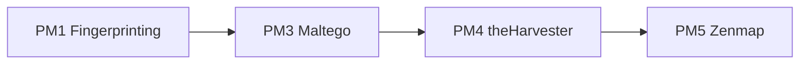

---

## 🎯 Objectives
- Collect domain registration, DNS, web-technology and perimeter-defence information about a target using six Kali Linux tools.
- Correlate a single domain into a graph of e-mail addresses, subdomains, mail servers and websites with Maltego.
- Harvest hostnames, IPs and email addresses from public sources with theHarvester.
- Identify the local subnet, discover live hosts, and capture IP and MAC addresses with Zenmap.
- Interpret every finding from an attacker's point of view and rate its risk.
- Recommend practical defensive improvements.
- Document commands, results, problems and lessons learned.

---

## 🛡️ Purpose of the Lab
These exercises build the skills used in the **Reconnaissance & Footprinting** and **Scanning & Network Discovery** phases of a penetration test.

Key capabilities practised:
- WHOIS and DNS intelligence gathering
- Web technology and WAF fingerprinting
- HTTP header analysis
- Link analysis and visual correlation of OSINT data
- Passive reconnaissance through search engines
- ARP/ICMP-based host discovery and topology mapping

> ⚠️ **Important:** Use these techniques only against systems you own or have explicit written permission to test. Unauthorised scanning or reconnaissance can be illegal.

---

## ⚙️ Environment & Tools

| 🧩 Component | ⚙️ Details |
| :--- | :--- |
| 🐉 Recon workstation | Kali Linux (`pentest-serv01`) |
| 🪟 Link analysis / scanning | Windows PC with Maltego Graph Desktop and Zenmap |
| 🔎 WHOIS | Domain registration data |
| 🌐 WhatWeb | Web technology fingerprinting |
| 📡 nslookup | DNS resolution (via 8.8.8.8) |
| 📥 curl | HTTP header inspection |
| 🧱 wafw00f v2.4.2 | WAF detection |
| 🗺️ dnsrecon | DNS enumeration |
| 🕸️ Maltego Graph 4.14.0 | Link analysis (Utilities transforms) |
| 🌾 theHarvester 4.11.1 | Passive OSINT |
| 🛰️ Zenmap / Nmap 7.99 | Host discovery and topology |

---

## 🪜 Practical Procedure

## Part 1. Footprinting with Six Kali Tools (W2-PM1)

### Step 1. WHOIS: domain registration
```bash
whois networkwalks.com
```
**Findings**
- Registrar: **GoDaddy.com, LLC**; created **2019-11-06**; registry expiry **2027-11-06**.
- Registrar locks enabled: `clientTransferProhibited`, `clientUpdateProhibited`, `clientRenewProhibited`, `clientDeleteProhibited`.
- Registrant and technical contacts hidden behind **Domains By Proxy, LLC** (WHOIS privacy).
- Name servers: `NS6135.HOSTGATOR.COM`, `NS6136.HOSTGATOR.COM` (registrar record also lists `NS29/NS30.DOMAINCONTROL.COM`). **DNSSEC: unsigned.**

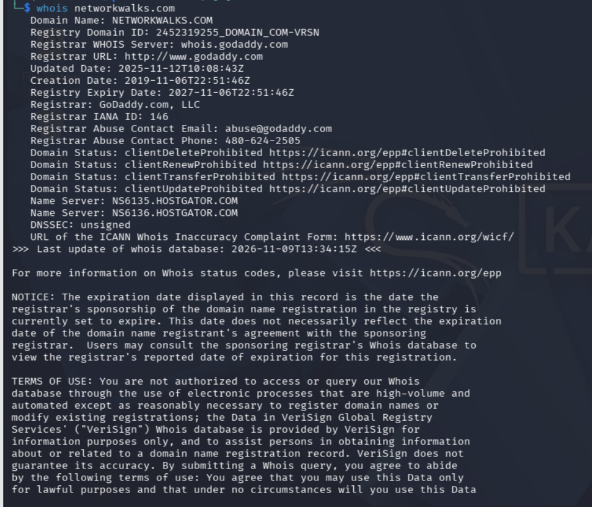
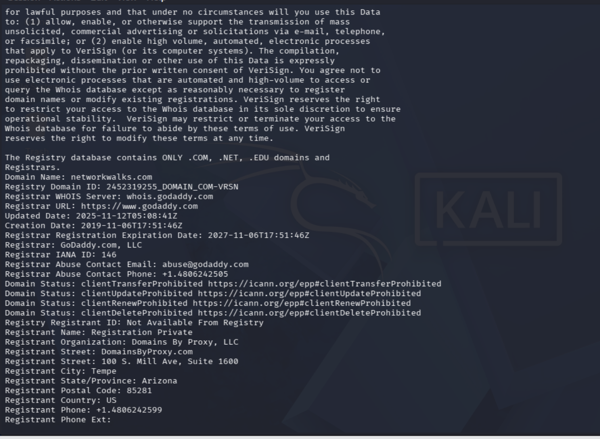
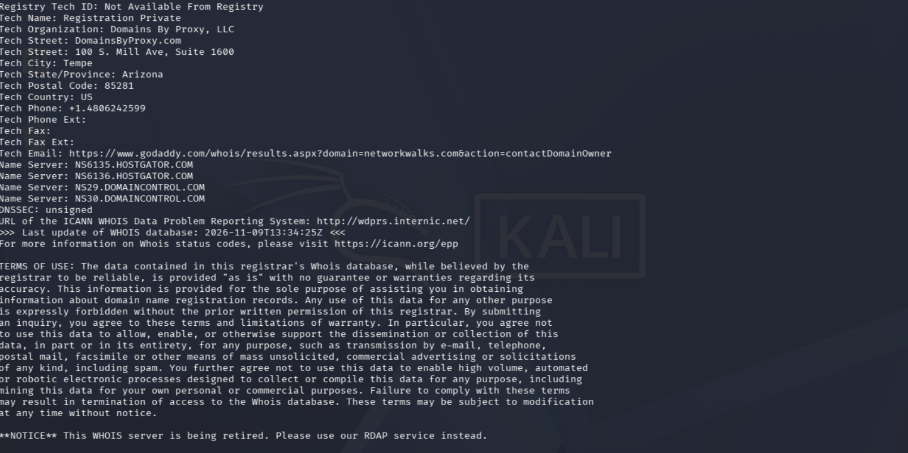
> *Description: WHOIS records showing registrar, dates, status flags, privacy service and name servers.*

---

### Step 2. WhatWeb: web technology fingerprinting
```bash
whatweb networkwalks.com
```
**Findings**
- HTTP `301` redirect to HTTPS, then `200 OK`.
- Server: **Apache**; CMS: **WordPress 7.1.4**; plugin: **WordPress Download Manager 3.3.76**.
- jQuery **3.7.1**, Bootstrap, Google Tag Manager, HTML5.
- IP **192.232.216.135**; public contact address `info@networkwalks.com`.

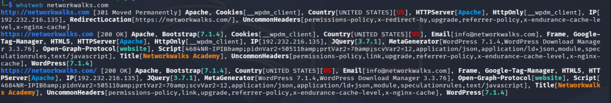
> *Description: WhatWeb identifying the CMS, plugin, libraries, server and IP address.*

---

### Step 3. nslookup: name resolution
```bash
nslookup networkwalks.com
```
**Finding:** the domain resolves to **192.232.216.135** (non-authoritative answer from `8.8.8.8`).

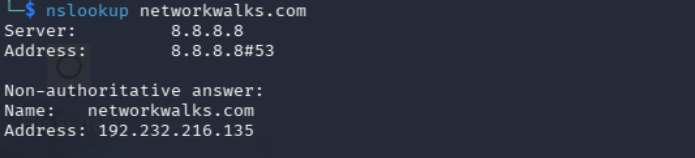
> *Description: DNS resolution of the target through a public resolver.*

---

### Step 4. curl: HTTP response headers
```bash
curl -i networkwalks.com
```
**Findings**
- `301 Moved Permanently` to `https://networkwalks.com/`; `Server: Apache`.
- `X-Redirect-By: WordPress - Really Simple Security` reveals the redirect plugin.
- `X-Endurance-Cache-Level` and `X-nginx-cache` expose the hosting cache layer.
- `Permissions-Policy` and `Referrer-Policy` are present. HSTS, `X-Content-Type-Options` and `X-Frame-Options` were **not** in this redirect response (the final HTTPS response should be checked separately).

> `curl -i` prints the headers plus the response using a normal GET request. `curl -I` sends a HEAD request.

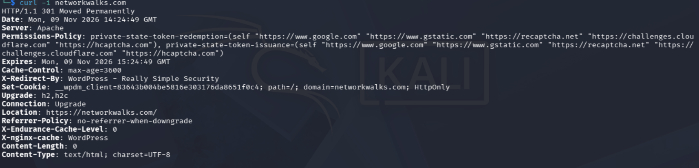
> *Description: HTTP headers returned by the target.*

---

### Step 5. wafw00f: WAF detection
```bash
wafw00f networkwalks.com
```
**Finding:** the site is behind **ModSecurity (SpiderLabs)**, detected with only **2 requests**.

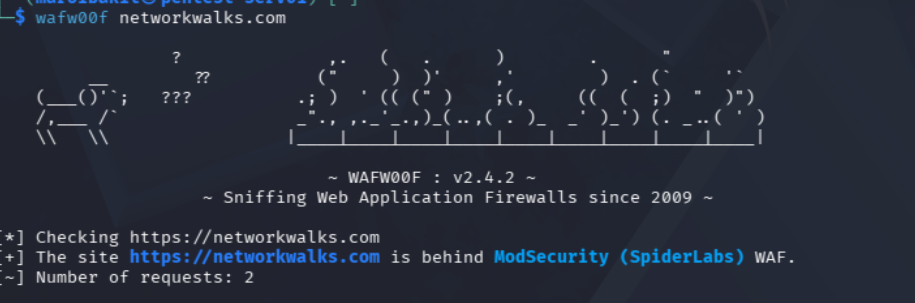
> *Description: wafw00f identifying the web application firewall.*

---

### Step 6. dnsrecon: DNS enumeration
```bash
dnsrecon -d networkwalks.com
```
**Findings**
- SOA/NS: `ns6135.hostgator.com` (50.87.144.87) and `ns6136.hostgator.com` (192.232.216.131), both disclosing **BIND 9.16.23-RH**.
- A and MX records both point to **192.232.216.135** (web and mail on one host).
- SPF: `v=spf1 +a +mx +ip4:50.87.144.87 +include:websitewelcome.com ~all` (soft fail).
- 8 SRV records for `_autodiscover._tcp` → `cpanelemaildiscovery.cpanel.net`, indicating a **cPanel**-managed account.
- No DNSSEC answer (consistent with WHOIS).

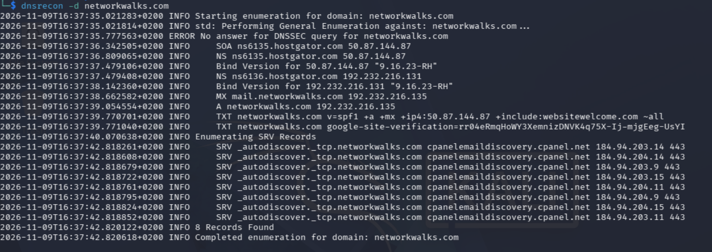
> *Description: DNS records, server banners, SPF/TXT and SRV records.*

---

## Part 2. Link Analysis with Maltego (W2-PM3)

A **Domain** entity for `networkwalks.com` was placed on a new graph in Maltego Graph (Desktop) 4.14.0 and expanded with Utilities transforms:

| Transform | Result |
| :--- | :--- |
| `To Emails @domain [Search Engine]` | 2 entities: `info@networkwalks.com` and a related web page |
| `To Email Addresses [PGP]` | Run on the domain and the e-mail; no new addresses added |
| `To DNS Name [SecurityTrails]` | **13 entities**: `cpcalendars`, `cpcontacts`, `autoconfig`, `www`, `whm`, `webdisk`, `cpanel`, `ftp`, `localhost`, `mail`, `autodiscover`, `webmail` and the apex domain |
| `To DNS Name - MX (mail server)` | `mail.networkwalks.com` |
| `To Website [Quick lookup]` | `www.networkwalks.com` |

Transform credits were tracked in the output window: the SecurityTrails lookup brought usage to **52 credits (148 remaining)**.

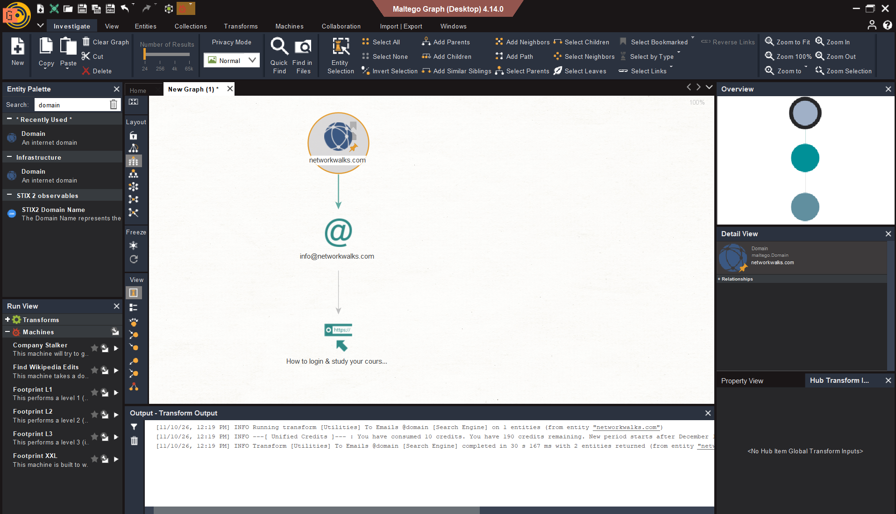
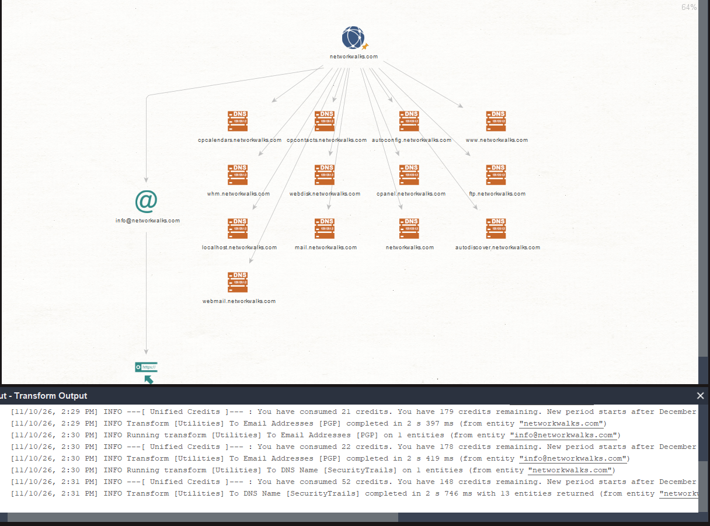
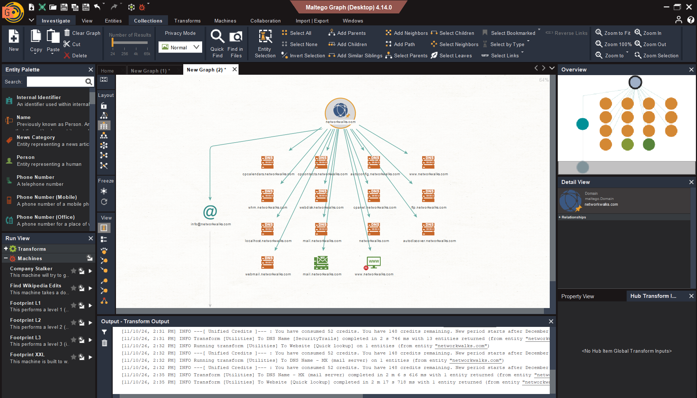
> *Description: Maltego graph linking the domain to its e-mail address, subdomains, MX host and website.*

**Analysis:** the subdomain pattern (`cpanel`, `whm`, `webmail`, `webdisk`, `cpcalendars`, `cpcontacts`, `autodiscover`, `autoconfig`) matches a standard cPanel account and agrees with the SRV records found by dnsrecon. The graph made it easy to see that all assets belong to one hosting environment.

---

## Part 3. Passive OSINT with theHarvester (W2-PM4)

```bash
theHarvester -d microsoft.com -l 1000 -b baidu
```
- Tool: theHarvester **4.11.1**; source: **Baidu**; result limit: **1000**.
- Result: **0 IPs, 0 e-mail addresses, 0 people, 6 hosts**:
  `account.microsoft.com`, `admin.exchange.microsoft.com`, `developer.microsoft.com`, `dynamicspartners.transform.microsoft.com`, `prod.support.services.microsoft.com`, `support.microsoft.com`.

> This is a **passive** technique: requests go to the search engine only, and no packets are sent to the target's infrastructure. A well-known public domain was used purely to demonstrate the tool.

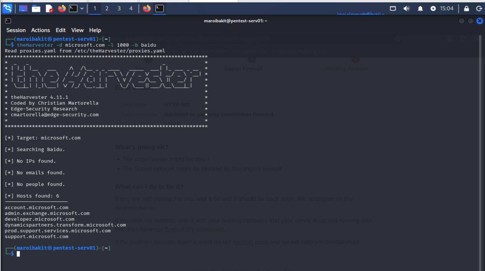
> *Description: theHarvester collecting hostnames from a public search engine.*

**Analysis:** even a single source returned hostnames whose labels reveal function and environment (`admin.exchange`, `prod.support.services`). Combining several sources (for example `crtsh`, `hackertarget`, `rapiddns`) would give a much more complete result.

---

## Part 4. Host Discovery with Zenmap (W2-PM5)

1. Identify the local IP address and subnet with `ipconfig` → LAN range **10.0.1.0/24**.
2. In Zenmap, set the target to `10.0.1.0/24` and select the **Ping scan** profile.
3. Zenmap runs the equivalent command:
   ```bash
   nmap -sn 10.0.1.0/24
   ```
4. Review the output, open the **Topology** tab, enable the legend and save the topology as a PDF.

**Result (10 Nov 2026, 09:07–09:08):** 256 addresses scanned → **50 hosts up**, 206 down, no ports examined (host discovery only).

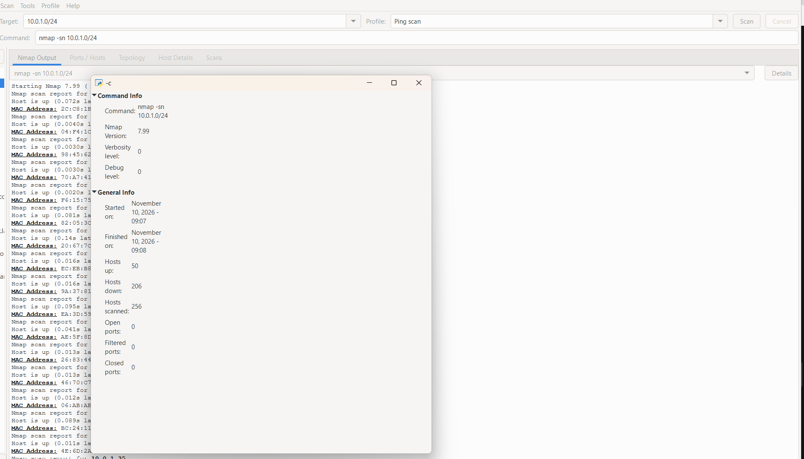
> *Description: Zenmap ping scan of the local /24 network with the scan summary.*

**Analysis**
- On a directly connected Ethernet segment Nmap uses ARP requests, so each live host is listed with its MAC address and vendor.
- Of the 16 MAC addresses partly visible in the screenshot, **9 have the locally administered bit set**. This is typical of randomised or private MAC addresses (modern phones, laptops) and virtual adapters, so those devices cannot be identified by vendor or tracked reliably by MAC alone.
- Fifty devices on one segment show how much a basic scan reveals: every address is a potential attack surface and must map to a known asset.

---

## 🔎 Consolidated Target Profile: networkwalks.com

| Attribute | Value |
| :--- | :--- |
| Registrar | GoDaddy.com, LLC (privacy-protected, registrar-locked) |
| Authoritative DNS | HostGator (`ns6135` / `ns6136`), BIND 9.16.23-RH, DNSSEC unsigned |
| Web / mail host | 192.232.216.135 |
| Web stack | Apache, WordPress 7.1.4, WP Download Manager 3.3.76, jQuery 3.7.1 |
| Control panel | cPanel/WHM (inferred from subdomains and SRV records) |
| Perimeter | ModSecurity (SpiderLabs) WAF, HTTP → HTTPS redirect |
| E-mail policy | SPF with soft fail (`~all`); DKIM/DMARC not assessed |

---

## ⚠️ Risk Summary

These are **observations, not confirmed vulnerabilities**. No exploitation or vulnerability validation was performed.

| # | Finding | Risk |
| :-: | :--- | :-: |
| 1 | CMS, plugin and library versions disclosed | 🟠 Medium |
| 2 | Management portals discoverable (`cpanel`, `whm`, `webmail`, `ftp`, `webdisk`) | 🟠 Medium |
| 3 | DNS server version disclosure (BIND 9.16.23-RH) | 🟠 Medium |
| 4 | Soft-fail SPF and unverified DMARC | 🟠 Medium |
| 5 | 50 live hosts on the LAN with randomised MAC addresses | 🟠 Medium |
| 6 | DNSSEC not enabled | 🟡 Low |
| 7 | Server IP and hosting provider identifiable | 🟡 Low |
| 8 | HTTP header information leakage | 🟡 Low |
| 9 | WAF vendor identifiable | 🟡 Low |
| 10 | Public e-mail address harvestable | 🟡 Low |
| 11 | Registrar vs registry name servers differ | 🟡 Low |
| 12 | Hostnames leaking through search engines | 🟡 Low |

**Positive controls observed:** ModSecurity WAF active, registrar lock and WHOIS privacy enabled, HTTP redirected to HTTPS, `Permissions-Policy` and `Referrer-Policy` headers present.

---

## ✅ Recommendations
1. **Reduce technology fingerprinting:** remove generator tags and version strings, set `ServerTokens Prod` / `ServerSignature Off`, and drop unneeded headers such as `X-Redirect-By`.
2. **Keep the CMS and plugins patched** and remove unused plugins.
3. **Harden HTTP security headers:** HSTS, `X-Content-Type-Options`, `X-Frame-Options` or CSP `frame-ancestors`.
4. **Restrict management interfaces** (cPanel, WHM, FTP, webmail) by IP allow-list or VPN, enforce MFA and brute-force protection, and delete unused DNS records.
5. **Improve DNS hygiene:** hide the BIND version, enable DNSSEC if supported, and reconcile registry and registrar name servers.
6. **Strengthen e-mail authentication:** publish DKIM and DMARC, then tighten SPF from `~all` to `-all`.
7. **Keep the WAF enabled and tuned**, and do not rely on it as the only defence.
8. **Maintain a LAN asset inventory:** scan regularly, compare with an authorised list, investigate unknown devices and use identifiers beyond MAC addresses (DHCP hostnames, 802.1X identities).
9. **Add network access control and segmentation** so unknown devices cannot join the main segment.
10. **Test only with authorisation.**

---

## 🐞 Problems Encountered & Solutions

### Problem 1. Maltego Java Installation Failed
The Maltego installer failed at the bundled Java step. The Windows Installer log showed:
```
Product: Eclipse Temurin JRE with Hotspot 17.0.8.1+1 (x64) -- Error 1500.
Another installation is in progress. You must complete that installation before continuing this one.
```
* **Investigation:**
  ```powershell
  Get-CimInstance Win32_Process -Filter "Name='msiexec.exe'" |
    Select ProcessId, CreationDate, CommandLine | Format-List
  ```
  This revealed a **Xerox Desktop Print Experience** MSI (`XrxSetup.msi`) launched from the Windows driver store at 08:13 that had hung for hours and held the global MSI lock. The Application log showed the same package failing earlier with error `1603`.

* **Workaround used:**
  ```powershell
  Stop-Process -Id <PID of the stuck msiexec> -Force
  Stop-Process -Id <helper msiexec PIDs> -Force
  Start-Service msiserver
  ```
  A mutex check on `Global\_MSIExecute` confirmed that the lock was free. The Maltego installer was then re-run as Administrator and completed successfully.

* **Follow-up:** the staged Xerox driver packages (`oem*.inf`) can be reviewed with `pnputil /enum-drivers` and removed with `pnputil /delete-driver <oemNN.inf> /uninstall` to stop further retries.

---

### Problem 2. Limited Maltego Transform Credits
Each transform consumes credits, and the account had a fixed allowance. The expensive SecurityTrails lookup alone used about 30 credits.
* **Approach:** run transforms deliberately, in order of value (e-mail → DNS names → MX → website), and monitor the credit counter in the Transform Output window instead of running every available transform.

---

## 💡 Key Learnings & Technical Takeaways

### 1. Reconnaissance Is Mostly Passive
A large amount of information (registration data, DNS layout, hosting provider, CMS version, WAF vendor) can be collected without exploiting anything.

### 2. Different Tools, Different Layers
WHOIS covers registration, WhatWeb and curl the web stack, nslookup and dnsrecon the DNS and mail layer, and wafw00f the perimeter defences.

### 3. Correlation Adds Value
Maltego turned separate results into a single graph, which made relationships (one hosting environment, one mail host) obvious.

### 4. OSINT Without Touching the Target
theHarvester showed that public search engines alone can leak hostnames and naming conventions.

### 5. Host Discovery and MAC Address Limits
A ping scan with ARP reveals every live host on a local segment, but randomised MAC addresses reduce the value of vendor lookups for inventory.

### 6. Troubleshooting Installers
A single hung MSI can block every other Windows installation. Checking `msiexec` processes, the MSI mutex and the Application event log pinpoints the cause quickly.

### 7. Documentation
Findings are only useful when they are clearly documented: what was done, what was seen, why it matters, and how to reduce the risk.

📄 **Full report:** [W2-PM-FINAL Penetration Testing Report (PDF)](report/W2-PM-FINAL-Report.pdf)

---

## 🔐 Security & Ethical Disclaimer
These activities were performed **strictly for educational, research and authorised security testing purposes**, against `networkwalks.com` (with written permission), public search-engine data (passively), and my own local network. The author and Networkwalks accept no responsibility for misuse of this material.

---

## 🔗 Tools & External Resources
* **Kali Linux:** [kali.org](https://www.kali.org)
* **Maltego:** [maltego.com](https://www.maltego.com)
* **theHarvester:** [github.com/laramies/theHarvester](https://github.com/laramies/theHarvester)
* **Nmap / Zenmap:** [nmap.org](https://nmap.org)
* **wafw00f:** [github.com/EnableSecurity/wafw00f](https://github.com/EnableSecurity/wafw00f)
* **dnsrecon:** [github.com/darkoperator/dnsrecon](https://github.com/darkoperator/dnsrecon)

---

## 👤 Author
**Tsepo Maroibaki**
* Network Operations Center & Cybersecurity
* Networkwalks Cybersecurity Program (Batch B084)
* **LinkedIn:** [https://www.linkedin.com/in/tsepo-maroibaki-88234921a](https://www.linkedin.com/in/tsepo-maroibaki-88234921a)
* **GitHub Repository:** [https://github.com/Maroibakit/NETWORKWALKS-B084-WK2-PM-FOOTPRINTING-SCANNING](https://github.com/Maroibakit/NETWORKWALKS-B084-WK2-PM-FOOTPRINTING-SCANNING)

---

📌 **Project Metadata:** `Program: Networkwalks Cybersecurity` | `Module: Week 02` | `Project: Footprinting, OSINT & Network Scanning`
